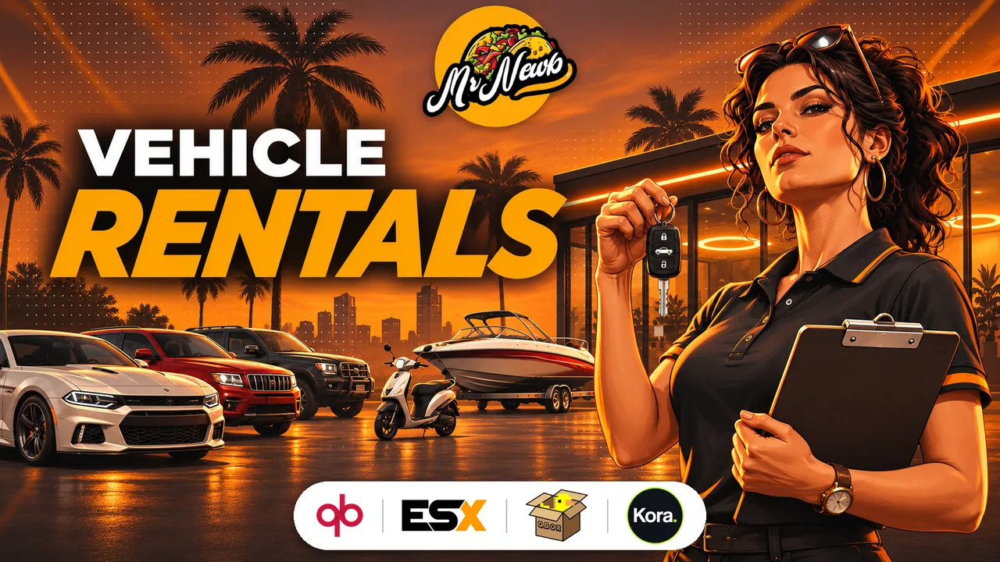
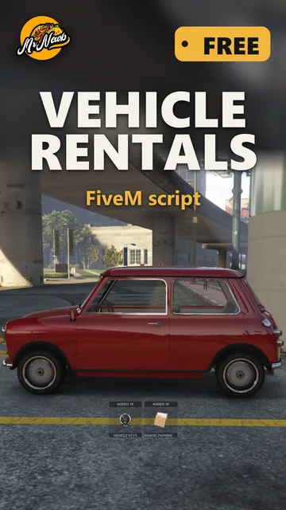

# MrNewbVehicleRentals



Rental desks (peds or props), a `rental_paperwork` item, and nearby returns. Cars, bikes, boats — whatever you put in stock.

[Documentation](https://mrnewb.github.io/docs/mrnewbvehiclerentals) · [Install guide](https://mrnewb.github.io/docs/mrnewbvehiclerentals/install) · [Tebex](https://mrnewbscripts.tebex.io/) · [Discord](https://discord.gg/mrnewbscripts) · [Short](https://www.youtube.com/shorts/xD9SaaADWsw)

<a href="https://www.youtube.com/shorts/xD9SaaADWsw"></a>

Documentation is available at https://mrnewb.github.io/docs/


## Features

- Desks as peds or props
- Stock can be cars, bikes, boats, or anything else in the list
- Bank charge on rent, bank refund on a valid return (no deposit)
- `rental_paperwork` item with plate, location, and vehicle metadata
- Nearby returns that check player, vehicle, and paperwork
- Vehicle keys and fuel through the bridge
- Shared map legend group for rental blips
- Resource stop cleans up active rental vehicles

## Install

Needs [ox_lib](https://github.com/overextended/ox_lib) and [Newb_Bridge](https://github.com/MrNewb/Newb_Bridge). Framework, inventory, fuel, and keys come through the bridge. Item paste and image: [install guide](https://mrnewb.github.io/docs/mrnewbvehiclerentals/install).

```cfg
ensure ox_lib
ensure Newb_Bridge
ensure MrNewbVehicleRentals
```

Add the `rental_paperwork` item. Copy `[INSTALL]/images/rental_paperwork.png` into your inventory images folder. It is not a usable item — return is from the desk menu.

## Config

`resource/open/shared/config.lua` — `Config.Agencies`. Each location key is the desk id (menu title, blip name, paperwork location). Fields: `coords`, `model`, `stock`, `vehicleSpawn`, `platePrefix`, optional `blip` / `animdata`.

`Config.BlipCategory` / `Config.BlipCategoryLabel` group desks under one map legend entry.

Shipped desks: Jims Discount Rentals (cars), Mayos Floaters (boats), Dickles Cheap Rentals (cars), Lees Wheely Good Bikes (BMX).

Field tables: [documentation](https://mrnewb.github.io/docs/mrnewbvehiclerentals).
